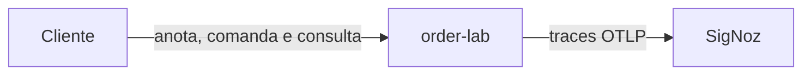
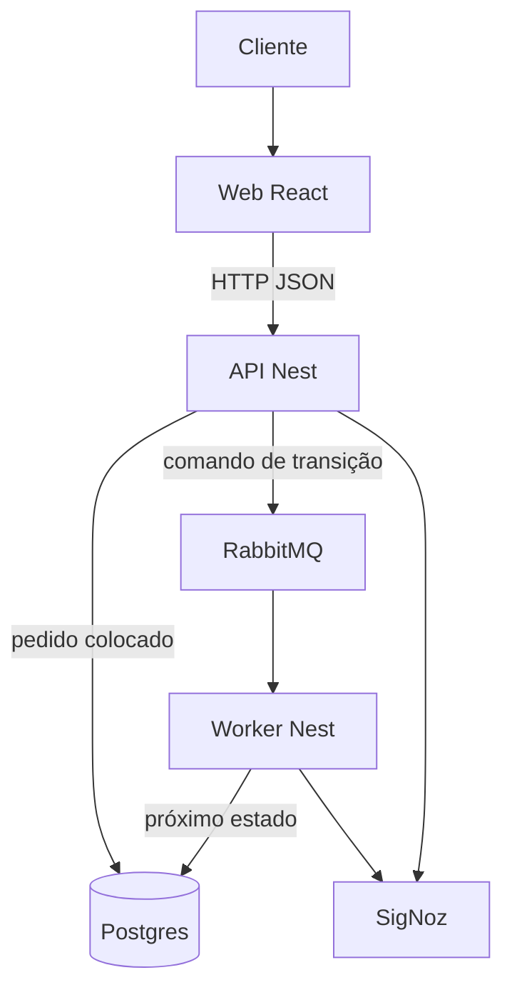

# Design Doc — Pedidos de balcão

- **Status:** Draft
- **Autores:** Rodrigo
- **Revisores:** N/A — laboratório individual, sem revisor
- **Time:** N/A — estudo individual
- **Data de criação:** 15/10/2026

---

## Visão Geral

Este documento descreve o order-lab pronto: um laboratório local para estudar Clean Architecture na prática, com um pedido de balcão de um item só. Quem abre o repositório vê como a aplicação fica construída e funcionando ao fim de todas as etapas.

O Cliente anota quem pediu, o que pediu e o valor. O pedido nasce colocado. Aceitar, preparar e entregar são comandos. Cada comando publica um evento, e um worker grava o estado seguinte. A lista mostra colocado, recebido, preparado e entregue.

---

## Escopo e Contexto

O laboratório segue a spec em `docs/features/pedidos.md`. Uma pessoa sobe a stack na própria máquina e estuda a regra de dependência com Postgres, Prisma, NestJS, React, RabbitMQ, Docker e um trace no SigNoz. Não há sistema de negócio externo, time de operação nem usuários além do estudante.

---

## Objetivos (Goals)

- [ ] Criar um pedido válido e vê-lo na lista como colocado, gravado no Postgres.
- [ ] Cada comando de aceitar, preparar ou entregar publica um evento, e o worker grava só o próximo estado permitido.
- [ ] A lista mostra o novo estado com p95 abaixo de 2 s depois do comando aceito, na máquina local.
- [ ] Criar o pedido e aceitar o comando HTTP ficam com p95 abaixo de 300 ms, medidos antes do worker.
- [ ] Um trace no SigNoz liga o comando HTTP, a publicação e o consumo do worker para o mesmo pedido.
- [ ] A stack local volta em até 5 minutos com o Compose, depois de uma queda.

---

## Fora de Escopo (Non-Goals)

- Autenticação, perfil de administração, cardápio, quantidade, estoque e pagamento.
- Cancelar ou editar o pedido, enquanto isso seguir em aberto na spec.
- Outbox, schema registry, réplica de banco e mais de um consumidor.
- SLA para alguém de fora do laboratório, plantão e meta de disponibilidade no formato 99,9%.
- Vários contextos de negócio, como pagamento e notificação em serviços separados.

---

# Design

## Arquitetura do Sistema

### Estrutura arquitetural

Monólito modular com uma fronteira assíncrona. O domínio do pedido fica isolado de framework. A API Nest e o worker Nest são dois processos que montam esse domínio. A tela React só fala HTTP com a API. A fila existe para o worker ser outro processo, de modo que o trace atravesse a mensagem.

Três serviços de negócio seriam mais do que o estudo precisa. Um único processo Nest deixaria a fila opcional e o trace no mesmo processo.

### Características arquiteturais mandatórias

| Característica | Prioridade | Por quê | Tradeoff aceito |
|---|---|---|---|
| Desempenho local | Alta | Criar e comandar em p95 abaixo de 300 ms; lista atualizada em p95 abaixo de 2 s | Sem cache, sem ajuste de query e sem meta acima de 5 comandos por segundo |
| Consistência da sequência de estados | Alta | O pedido só anda colocado, recebido, preparado, entregue, um passo por vez | O comando responde que o evento foi anunciado; a lista mostra o estado novo depois que o worker grava |
| Observabilidade de um pedido | Alta | O estudo precisa ver o mesmo pedido no HTTP, na fila e no worker | SigNoz local pesa na máquina; não há alerta que acorde alguém |
| Recuperabilidade da sessão | Média | Se a stack cair, `docker compose up` a traz de volta em até 5 minutos | Sem réplica, sem failover e sem SLA externo |

Escalabilidade horizontal e alta disponibilidade ficam de fora. O volume de desenho é de até 100 pedidos no Postgres e pico de 5 comandos por segundo, com uma pessoa usando o sistema.

### Decisões arquiteturais

- O domínio não importa NestJS, Prisma nem o cliente da fila.
- A API grava o pedido novo como colocado. Só o worker grava recebido, preparado e entregue.
- A API publica o comando somente quando o estado atual permite aquele passo.
- O worker aplica o passo somente quando o estado atual permite. Mensagem repetida no estado alvo é confirmada e não cria outro pedido.
- Um pedido é um item: nome, descrição e valor em reais.

### Princípios de design

- A dependência aponta para o domínio. Framework fica na borda.
- HTTP com JSON e mensagem JSON bastam para o laboratório.
- O repositório usa npm, com a API e o worker como dois entrypoints.

### Diagrama C4 — Contexto

O Cliente é a única pessoa. Ele anota o pedido, dispara os comandos e olha a lista. O order-lab não conversa com sistema externo de negócio. SigNoz recebe telemetria; não é um ator de negócio.

### Diagrama C4 — Container

Uma chamada HTTP manual usa a mesma API, sem passar pela tela.

### Contratos e integrações

- `POST /orders` cria o pedido colocado, com nome, descrição e valor.
- `POST /orders/{id}/accept`, `POST /orders/{id}/prepare` e `POST /orders/{id}/deliver` publicam o comando do passo.
- `GET /orders` e `GET /orders/{id}` devolvem o estado atual para a lista.
- Três mensagens, uma por passo, carregam o identificador do pedido. Os nomes de negócio são aceitar, preparar e entregar.
- A API responde erro quando a publicação falha ou quando o estado atual não permite o passo. O pedido permanece no estado anterior.
- Sucesso do comando significa que o evento foi anunciado. O estado novo aparece na consulta depois que o worker grava.

### SLA / SLO / SLI

- **SLI (o que medimos):** latência HTTP de criar e de comandar; tempo até a lista mostrar o novo estado; presença de um trace do comando até o worker; tempo para a stack local voltar depois de caída.
- **SLO (alvo interno):** p95 abaixo de 300 ms no HTTP síncrono; p95 abaixo de 2 s até a lista atualizar; um trace visível no SigNoz por comando; retorno da stack em até 5 minutos.
- **SLA (compromisso externo):** N/A — não há usuário externo. O teto de volume é 100 pedidos e 5 comandos por segundo na máquina local.

---

## Design de Dados

O Postgres é a fonte da verdade do pedido. O status precisa de uma transição condicional, e o volume cabe em uma tabela. O Prisma é o acesso a essa tabela. O valor fica em reais com centavos, como na spec. Os status de código `INCLUDED`, `RECEIVED`, `PREPARED` e `DELIVERED` correspondem a colocado, recebido, preparado e entregue.

A comunicação síncrona é HTTP com JSON, porque a tela e a chamada manual são os dois clientes. A comunicação do passo de estado é mensagem no RabbitMQ, porque o worker precisa ser outro processo para o trace cruzar a fila. Protobuf e gRPC não entram: o contrato é pequeno e o estudo não pede schema registry.

O padrão de acesso é de uma pessoa: poucas escritas e leitura da lista depois de cada comando. Não há pico de produção. A escrita inicial do pedido é transacional no Postgres. A mudança de estado é eventual em relação ao HTTP: consistente depois que o worker confirma a mensagem, dentro do alvo de 2 s.

---

## Plano de Testes e Observabilidade

- **Testes:** mandatórios são os testes de unidade da máquina de estados e dos casos de uso, sem subir Nest, banco ou fila. A aceitação percorre os critérios de `docs/features/pedidos.md`: criar, comandar, consultar e recusar passo fora de ordem. Teste de carga não é portão; 5 comandos por segundo é teto de desenho, não meta de campanha.
- **Métricas de sucesso (obrigatório):** um pedido percorre os quatro estados na ordem, a lista mostra cada um, e o SigNoz exibe um trace contínuo do comando HTTP até o worker para esse pedido.
- **Monitoramento:** trace OTEL na API, na publicação, no consumo e na escrita do worker. O identificador do pedido segue no trace. Log do worker registra mensagem repetida e passo recusado.
- **Alertas e dashboards:** N/A para plantão — não há quem acionar. Durante a sessão, o estudante abre o trace do pedido no SigNoz e confere a latência do comando.

---

## Cronograma e Fases (Milestones)

| Fase | Entrega | Tamanho | Situação | Responsáveis | Dependências |
|---|---|---|---|---|---|
| 1 | API NestJS com o módulo HTTP de pedidos | P | Concluída | Rodrigo | Nenhuma |
| 2 | Postgres no Docker e modelo Prisma do pedido, com os quatro status | P | Concluída | Rodrigo | Fase 1 |
| 3 | Gravar e listar o pedido colocado | P | Planejada | Rodrigo | Fase 2 |
| 4 | Máquina de estados e comandos HTTP que publicam | M | Planejada | Rodrigo | Fase 3 |
| 5 | Worker aplica aceitar, preparar e entregar | M | Planejada | Rodrigo | RabbitMQ e fase 4 |
| 6 | Tela para anotar, listar e disparar os comandos | M | Planejada | Rodrigo | Fase 4 |
| 7 | Compose com Postgres, RabbitMQ, API, worker e web | M | Planejada | Rodrigo | Fases 5 e 6 |
| 8 | Trace no SigNoz do comando até o worker | M | Planejada | Rodrigo | Fase 7 |

---

## Próximos Passos

- Gravar e listar o pedido colocado — Rodrigo, fase 3
- Isolar a máquina de estados em testes de unidade e publicar os comandos HTTP — Rodrigo, fase 4
- Fechar, na spec, tamanho máximo, texto de erro e se cancelar ou editar entra no laboratório — Rodrigo

---

## Decision Logs

| Decisão | Alternativas consideradas | Motivo da escolha |
|---|---|---|
| Cada passo é um comando HTTP que publica um evento, e o worker grava o estado | Worker avança sozinho os quatro estados; só o primeiro passo usa fila e o resto é HTTP síncrono | O Cliente, ou uma chamada manual, dispara o passo. Cada comando vira um trace. A simulação automática esconderia o ator do comando |
| Alvos locais: p95 de 300 ms e 2 s, pico de 5 comandos por segundo, retorno em 5 minutos | Metas de serviço em produção, como 99,9% de disponibilidade | O laboratório tem uma pessoa e uma máquina. Disponibilidade de produção seria um número sem medição |
| Só o worker grava a transição de estado | A API grava o estado e também publica | Dois escritores disputam o mesmo status. Com um escritor, falha na publicação deixa o estado como está |
| A API recusa o passo ilegal antes de publicar, e o worker repete a checagem | Só o worker decide, e a tela descobre pela lista | A spec pede o estado anterior preservado e uma recusa perceptível. A checagem dupla cobre mensagem fora de ordem |
| Postgres e Prisma | Documento ou outro banco | O pedido cabe em uma tabela com transição de status |
| RabbitMQ entre API e worker | Chamada em memória no mesmo processo | A fila só se justifica com outro processo, que é o que o trace precisa atravessar |
| Sem outbox nesta versão | Outbox na mesma transação da escrita | Na transição, a API não grava o estado novo. Ela publica, e o worker grava. O outbox seria a peça seguinte se os dois efeitos precisassem da mesma transação |
| npm e um repositório | pnpm com vários repositórios | Um laboratório deste tamanho cabe em um repositório e em um gerenciador |
| Clean Architecture de estudo, com domínio sem framework | Espelhar o template de produto da Allos | O objetivo é aprender a regra de dependência em um laboratório pequeno. As premissas de shopping, lojista e monetização não governam este repositório |

---

## Referências

- [Spec funcional — docs/features/pedidos.md](features/pedidos.md)
- [README do repositório](../README.md)
- [Schema Prisma — prisma/schema.prisma](../prisma/schema.prisma)
- [ADR-001 — Transição de estado por comando](../adrs/ADR-001-transicao-de-estado-por-comando.md)
- [ADR-002 — Domínio de pedido sem framework](../adrs/ADR-002-dominio-de-pedido-sem-framework.md)
